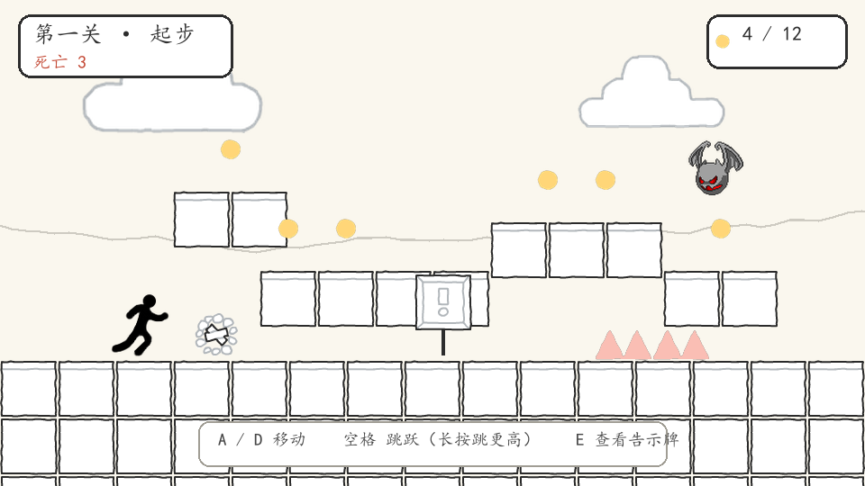
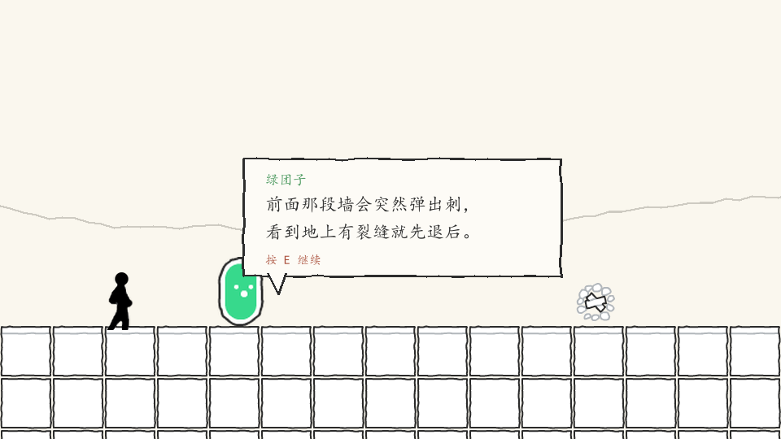
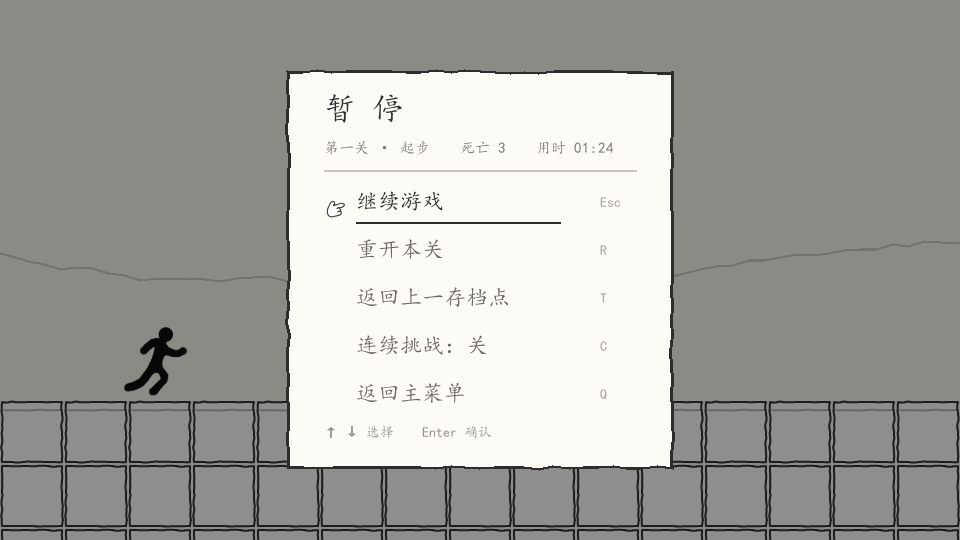

# 《火柴人跑酷》设计与开发文档

> 2D 横版精准平台跳跃（跑酷 + IWANNA 机关）· Python + pygame · 海龟编辑器
> 状态：**设计方案已确认；M0 环境验证已通过（Python 3.6.5 / pygame 1.9.6）**
> 最后更新：2026-11-23

**当前进度**：`✅ 设计` → `✅ M0 环境` → `✅ M1 骨架` → `✅ M2 手感` → `✅ M2.5 角色动画` → `✅ M3 第一关` → `⬜ M4 机关` → `⬜ M5 道具` → `⬜ M6 扩展关卡` → `⬜ M7 UI/存档` → `⬜ M8 打磨`

当前目录已包含 `main.py`、`config.py`、`compat.py`、`assets/`（124 个素材文件）、`levels/`、`docs/` 与 `tools/`；M0 已在**海龟编辑器真实环境**中验证通过，尚未实现任何玩法。

---

## 0. 这份文档怎么用

这份 README 同时承担两个职责：

1. **设计方案**——给你评审，确认玩法和范围。
2. **交接文档**——后续编码时（或上下文丢失时），照第 5～11 章的参数、图例、模块划分直接往下写，不需要重新决策。

**如果你只想知道结论**：看第 1 章和第 23 章（已确认玩法决策）。第 23 章是用户最终确认结果；若初版章节中的描述与第 23 章冲突，以第 23 章为准。

> **最终决策优先级：第 23 章。** 初版曾以三关作为示例结构；用户已确认关卡按教学、显性机关、隐形机关三类组织，实际关卡数量可以增加。

---

## 1. 一句话方案

用 `source/` 里的 Kenney 手绘涂鸦素材（黑线 + 白纸 + 淡彩）并使用 `火柴人.zip` 提供的 21 帧纯黑火柴人剪影，做一个 **960×540、60 FPS 的横版跑酷**；关卡按教学、显性机关、隐形机关三类组织，不限定关卡总数：

- 可先各制作一个教学关、显性机关关和隐形机关关作为首批内容，后续允许继续增加关卡。
- 死亡不结束游戏，**回到上一处篝火存档点**，死亡数全程计数。
- 手感按"**上升轻、下落重**"调：可变跳跃高度 + 土狼时间 + 跳跃缓冲。
- 道具：**滑翔伞**（长按减速滑翔）与**冲刺**（短距突进），在适合的关卡中逐步授予。

### 已确认的技术底座

| 项 | 结论 | 依据 |
|---|---|---|
| 编辑器 | 海龟编辑器（编程猫） | 你的要求 |
| 图形/音频 | `pygame` | 海龟编辑器「库管理 → 游戏」可装 Pygame / Pygame Zero |
| 框架 | **直接用 pygame**，不用 Pygame Zero | 需要精确控制地面检测、抖动、逐帧碰撞；PGZ 的 Actor 模型反而碍事 |
| 窗口 | 960×540，固定，目标 60 FPS | 64px 瓦片 → 15×8.4 格视野；角色图片约 96px 高，碰撞盒独立配置 |
| 本机验证 | **已实测**：海龟编辑器 `D:\tools\Pyblock`，内置 **Python 3.6.5 + pygame 1.9.6**，无头与真实窗口（windib）均运行通过 | 2026-11-23 实机核对，不再引用旧记录 |

> ⚠️ 海龟编辑器的 Pygame 是**内置的 1.9.6**，不需要也不应该去「库管理」再装一遍（装新版会和内置解释器冲突）。直接打开 `main.py` 按运行即可。

> ⚠️ **pygame 1.9.6 API 边界**（实测，2026-11-23）：没有 `draw.rect(border_radius=)`、没有 `Rect.clipline()`、没有 `pygame.SCALED`、没有 `math.dist`。圆角面板、线段裁剪、距离计算统一走 `compat.py`，业务代码里禁止直接调用这些新 API。另：无头模式下 `set_mode` 默认返回 **8 位调色板表面**（文字变实心块、透明贴图贴不上），必须显式传 `depth=32`，`compat.make_display()` 已封装。

> ⚠️ **Windows 默认编码是 GBK**：`open()` 读 UTF-8 中文会抛 `UnicodeDecodeError`。读写文本一律走 `io_utils`。
>
> 完整的环境事实、已修复问题、潜伏问题与预防方案见 **[docs/环境适配说明.md](docs/环境适配说明.md)**；改动代码前先跑 `python tools/envcheck.py`（18 项自检）。

**三条硬规则**：① 建窗口只调 `compat.make_display()`；② 画圆角/裁剪/距离只调 `compat.*`；③ 读写文本只调 `io_utils.*`。

---

## 2. 美术方向：为什么这套素材能撑住

`source/` 里 12 个包，能用的其实只有两个系列，其余是**别的画风**：

| 素材包 | 风格 | 结论 |
|---|---|---|
| `kenney_scribble-platformer` | 手绘涂鸦：黑描边 + 白纸填充 + 轻微抖动线 | ✅ **主素材**：地形、地刺、金币、门、旗、UI 数字 |
| `kenney_scribble-dungeons` | 同上，室内道具 | ✅ **补充**：篝火（存档点）、箱子、木桶、墙刺、陷阱板 |
| 火柴人 `images/hero` | 纯黑剪影 | ✅ **主角**，与黑描边语言同源 |
| `kenney_sketch-town / desert / town-expansion` | 等距 3D 小房子 | ❌ 俯视 45°，横版用不上 |
| `kenney_rpg-urban-pack` | 16×16 像素 RPG | ❌ 尺寸与画风都不符 |
| `kenney_block-pack` | 3D 方块 | ❌ 无关 |
| `FarmValley-Basic` | 农场卡通 | ❌ 无关 |

**统一策略（关键）**：这套素材全是白色填充，危险物与地面长得几乎一样。所以统一用「**白底黑线 + 功能色**」区分：

| 功能 | 颜色 | 做法 |
|---|---|---|
| 地面 / 平台 | 纸白 `#FBFAF6` + 黑线 | 原图直用 |
| 危险（刺、落石） | 淡红 `#F7C9BE` | 白填充乘算染色，黑线保留 |
| 收集（金币） | 金黄 `#FFD678` | 同上 |
| 存档点 | 橙 `#F2A44B` | 篝火点亮时染色 |
| 主角 | 纯黑 `#141414` | 原图 |
| 背景远山 | 铅笔灰 `#CECBC2` | 程序绘制 |
| 纸底 | `#FAF7EE` | 纯色 + 极淡噪点 |

染色用 `BLEND_MULT` 在加载时做一次并缓存，运行时零开销。

### 画面示意（真实素材拼合，非手绘）

**第一关**——注意红色尖刺与绿色草面靠颜色区分，不靠形状：



**NPC 对话**——气泡与面板由代码绘制（手绘抖动边框），保证任意尺寸都清晰：



**暂停菜单**——`ui_hand` 素材做选中手：



> 这三张是用 PIL 把真实素材拼出来的**效果验证图**，不是最终截图；实际游戏由 pygame 实时渲染，字体为楷体。

---

## 3. 素材清单与用途映射

素材文件的准确内层路径与实际用途以独立文件《素材清单_修订版.md》为准。将其指定文件从 `source.zip` 中对应的内层素材 ZIP 解压后拷入 `assets/`；不要假定 `source/_x/` 或 `火柴人/` 目录必然存在。

### 3.1 地形（`kenney_scribble-platformer/PNG/Default`，64×64）

| 文件 | 用途 |
|---|---|
| `tile.png` | 地面填充（内部格） |
| `tile_top.png` | 地面表层 / 平台顶 |
| `tile_grass.png` | 锯齿状装饰/特殊边缘素材；不得直接作为普通地面表层或地刺碰撞依据 |
| `tile_stone.png` | 石质墙（第 2 关） |
| `tile_slope.png` | 斜坡（可选，先不做） |
| `tile_spikes.png` | 地刺（烫红） |
| `tile_spike.png` | 尖刺球 / 悬挂刺（烫红） |
| `tile_water.png` | 水池（死亡区，烫蓝） |
| `tile_coin.png` | 金币（烫金） |
| `tile_gem.png` | 大宝石（可选奖励） |
| `tile_flag.png` | 终点旗 |
| `tile_door.png` / `tile_blockDoor.png` | 终点门 |
| `tile_ladder.png` | 梯子（可选） |
| `tile_arrowUp.png` | **弹跳板**（踩上弹起） |
| `tile_arrowLeft/Right.png` | 传送带方向（移动平台贴图） |
| `tile_crate.png` / `tile_block.png` | 可推箱子 / 机关砖 |
| `tile_bush.png` / `tile_tree.png` | 装饰 |
| `background_cloudA/B.png` | 视差云 |
| `background_tree.png` | 中景树 |
| `ui_num0`～`ui_num9` / `ui_numX` | HUD 数字（可选，替代文字） |
| `ui_hand.png` | 菜单选中手 |
| `ui_balloon.png` | 参考造型（**不用来拉伸**，气泡由代码画） |

> **M0 实测发现（重要）：** `tile.png` 与 `tile_top.png` 是**带内缩边框的单块贴图**，按 64px 直接平铺会出现"每格一道双边框 + 白缝"，不能当连续地面用。M3 起地面改为"纸白填充 + 代码绘制手绘顶线 + 短竖纹"，`tile_*` 只用于独立方块、悬浮平台和机关砖；若后续确实需要贴图地面，必须先做无缝化处理（裁掉内缩边框或重绘）。

### 3.2 室内道具（`kenney_scribble-dungeons/PNG/Default (64px)`）

| 文件 | 用途 |
|---|---|
| `campfire.png` | **存档点**（未点亮=灰线，点亮=烫橙） |
| `wall_trap.png` | 天花板落刺（旋转 90° 贴墙） |
| `trap.png` | 隐藏陷阱板（踩上 0.2s 弹出刺） |
| `chest.png` | 奖励箱（首次打开给金币/道具） |
| `crate.png` / `barrel.png` | 装饰 / 可推障碍 |
| `door_closed.png` / `door_open.png` | 关卡出口 |
| `coffin.png` | 死亡特效参考（可选） |

### 3.3 角色与敌人（`火柴人/`）

| 文件 | 用途 |
|---|---|
| `images/hero/runright0.png`～`runright7.png` | 右跑 8 帧（12 FPS） |
| `images/hero/runleft0.png`～`runleft7.png` | 左跑 8 帧 |
| `images/hero/jumpright.png` / `images/hero/jumpleft.png` | 右向/左向跳跃姿态 |
| `images/hero/standright.png` / `images/hero/standleft.png` | 右向/左向待机姿态 |
| `images/hero/land.png` | 落地姿态/落地反馈帧（具体表现以素材预览为准） |
| `images/enemy/bat0.png`～`bat4.png` | 蝙蝠（5 帧，正弦巡逻） |
| `images/enemy/bat.png` | 蝙蝠静态/备用图 |
| `images/enemy/ufo.png` | UFO 敌人（水平巡逻 + 上下浮动） |
| `images/enemy/bird_fly1-4.png` | 飞鸟敌人（4 帧飞行动画，可选） |
| `images/item/star.png` | 备用收集物（可与金币互换） |
| `images/item/snow.png` | 死亡/落地粒子 |

**素材功能色处理（必须执行）：** 当前白底黑线素材中的草地、尖刺、金币等形状可能相近，不能只依赖轮廓区分功能。统一保留黑色线稿，在不遮盖线条的前提下按用途染色：危险物使用淡红/红色提示，金币使用金黄色，篝火使用橙色；普通地形保持低饱和中性色。颜色是功能编码，必须在素材清单和实际导入时一致。

### 3.4 音频（内层路径均以 `Audio/` 开头，`.ogg`）

以下音效分属不同的外层素材 ZIP：`source/sounds/kenney_interface-sounds.zip` 与 `source/sounds/kenney_impact-sounds.zip`。表中列出完整内层路径；不要把 `interface/`、`impact/` 当作实际目录。

| 事件 | 文件 | 备注 |
|---|---|---|
| 跳跃 | `Audio/pluck_001.ogg`（`kenney_interface-sounds.zip`） | 短促、上扬 |
| 落地 | `Audio/impactSoft_medium_000.ogg`（`kenney_impact-sounds.zip`） | 轻 |
| 金币 | `Audio/select_002.ogg`（`kenney_interface-sounds.zip`） | 清亮 |
| 存档点亮 | `Audio/confirmation_001.ogg`（`kenney_interface-sounds.zip`） | |
| 死亡 | `Audio/impactPunch_heavy_001.ogg`（`kenney_impact-sounds.zip`） + `Audio/error_004.ogg`（`kenney_interface-sounds.zip`） | 叠加 |
| 机关触发 | `Audio/switch_003.ogg`（`kenney_interface-sounds.zip`） | |
| 冲刺 | `Audio/switch_001.ogg`（`kenney_interface-sounds.zip`） | |
| 滑翔 | 无（循环风声可省） | |
| 通关 | `music-jingles/*` 里挑一个 3～5 秒的 | 见包内子目录 |
| BGM | **第一版不启用背景音乐** | 早期素材包的 BGM 仅保留备选；后续如需启用，另行确认 |

> `.ogg` 在 pygame 2.x 默认支持。若目标机器播放失败，用 ffmpeg 批量转 `.wav`（提供一句话脚本即可）。

### 3.5 缺口：需要"造"的 3 个小素材

| 缺什么 | 方案 |
|---|---|
| **滑翔伞** | 代码绘制：下半圆弧（手绘抖动）+ 两条绳 + 黑描边，挂在角色头顶 24px。不找素材，风格反而更稳 |
| **告示牌** | 木桩（2 条线）+ `tile_item.png` 当木板，见效果图 |
| **弹簧板** | 直接用 `tile_arrowUp.png` 烫橙 |

---

## 4. 核心玩法

### 4.1 一句话循环

**看地形 → 预判 → 跳/滑翔/冲刺 → 落地 → 下一段**，死了立刻回篝火重来。

### 4.2 操作

| 键 | 功能 |
|---|---|
| `A` `D` / `←` `→` | 左右移动（有加速度） |
| `Space` / `K` | 跳跃；**按住跳更高**；空中按住=滑翔（需道具） |
| `J` | 冲刺（需道具） |
| `E` / `↑` | 交互：读告示牌、和 NPC 说话、点亮篝火 |
| `Esc` | 暂停菜单 |
| `R` | 重开本关（回关卡起点，死亡数不清零） |
| `T` | 返回上一存档点（不增加死亡数，手动用） |
| `C` | 切换「连续挑战」 |
| `Q` | 暂停菜单里返回主菜单 |

---

## 5. 手感参数（**这是本项目最需要打磨的部分**）

所有数值单位：像素、秒。60 FPS 下用 `dt` 积分，避免掉帧变速。

| 参数 | 值 | 说明 |
|---|---|---|
| 重力（上升） | 1900 px/s² | 上升**轻** |
| 重力（下落） | 2600 px/s² | 下落**重**（1.37 倍） |
| 起跳初速度 | −640 px/s | 约 1.7 格高 |
| 松手切跳 | `vy *= 0.42` | 轻点=矮跳，按住=高跳 |
| 按住加长 | 上升期重力 ×0.85 | 长按额外约 0.5 格 |
| 最大下落速度 | 1100 px/s | 防穿透 |
| 跑速上限 | 300 px/s | |
| 第一关普通坑洞宽度建议 | **最多 2 格（128px）** | 按起跳 `−640px/s`、上升重力 `1900px/s²`、下落重力 `2600px/s²`、水平速度 `300px/s` 估算；3 格不作为普通跳跃可通过的设计标准 |
| 地面加速度 | 2200 / 减速 2800 | 起步不肉、刹车不飘 |
| 空中加速度 | 1500 | 空中控制比地面弱 |
| **土狼时间** | 0.10 s | 离开平台后仍可跳 |
| **跳跃缓冲** | 0.12 s | 落地前按跳，落地瞬间自动起跳 |
| 落地压扁 | 0.08 s，`scaleY=0.85` | 冲击感 |
| 滑翔下落上限 | 120 px/s，水平 330 px/s | 明显"飘" |
| 冲刺 | 560 px/s，持续 0.16 s，冷却 0.8 s | 可穿小刺（可选：无敌 0.12s） |

**判定体**：角色 34×76 的碰撞盒（比 96px 图小，留出容错），脚底与瓦片交界留 2px 容差 —— 这就是"跳跃判定宽容"的来源。

> 数值先按上表实现，再在 `config.py` 里做成可调，用调试面板（F1）实时改，手感定型后写死。

---

## 6. 关卡设计

关卡按性质分为教学关、显性机关关、隐形机关关，不限定总数。首批可各制作一个样板关卡；时长参考见第 23 章。关卡宽度按玩法段落制作，不预先强制固定格数。

### 6.1 第一关「起步」——只教，不杀

```
[起点] → 走 → 小坑(教跳) → 高台阶(教长按) → 金币引导 → 篝火(教存档)
      → 连续平台(教节奏) → [终点旗]
```

- 全程**无敌人、无刺**，唯一风险是掉坑。第一次掉坑触发教学提示且不计死亡；第一关第二次及之后掉坑正常计数，按检查点规则重生。
- 引导方式：**跟随式气泡**（屏幕上方 1/3 处，半透明，不挡视线），共 5 条，触发一次即永久消失（可在设置里重看）。

| 触发位置 | 文案 |
|---|---|
| 起点 | `A / D 移动，跟着箭头走` |
| 第一个坑前 | `空格跳跃。轻点跳得矮，按住跳得高` |
| 高台阶前 | `按住空格不放，能跳更高` |
| 第一个篝火 | `篝火是存档点，按 E 点亮。死了会回到这里` |
| 终点前 | `旗子是终点，走进去就过关` |

### 6.2 显性机关关样板「告示牌」——教机关

新机关：**移动平台、蝙蝠、UFO、落石、弹跳板**。

- 每个新机关**第一次出现前 3 格**立一块告示牌，按 `E` 弹出说明面板（游戏暂停，不打断节奏）。
- 关卡中段有 NPC「绿团子」，给**滑翔伞**并演示大跨度滑翔段。
- 结尾有一段"三连跳 + 弹跳板"作为综合考核。

| 告示牌 | 文案要点 |
|---|---|
| 移动平台 | `黄色箭头表示它会往哪走。等它靠近再上，别抢` |
| 蝙蝠 | `可以从头顶踩踏击败；从侧面或其他方向碰到会立即死亡并重生。观察它的轨迹，找准时机从上方落下` |
| 落石 | `地上有影子就是要掉石头了。影子出现就躲开` |
| 弹跳板 | `踩上去会弹很高，落点要提前想好` |

### 6.3 隐形机关关样板「暗算」——IWANNA 式

规则：**死亡极快（0.35 秒重生）、篝火密集、机关有"可读线索"但不明显**。

| # | 机关 | 表现 | 线索（公平性保障） |
|---|---|---|---|
| 1 | 伪装地砖 | 看着是平地，踩上 0.2s 后塌陷 | 砖缝略深、踩上有一声轻响 |
| 2 | 天花板落刺 | 走过触发区，`wall_trap` 从顶上砸下 | 上方有 1px 黑线抖动 0.3s |
| 3 | 隐形地刺 | 地面有裂纹，靠近 0.15s 后弹起 | 裂纹 + `warning` 音效极轻 |
| 4 | 突墙 | 平地突然升起一堵墙挡住去路 | 墙面比地面白一点点 |
| 5 | 二段落石 | 第一块落石骗你往前，第二块在落点 | 第二块的影子先出现 |
| 6 | 假终点（可选彩蛋） | 旗子是画上去的，穿过没反应 | 旗子不飘 |

**不做**：无法预判的随机陷阱、屏幕外偷袭、必须死一次才能过的关（除非那一死是设计好的"教学死"，且后面给提示）。

---

## 7. 引导系统（三层）

| 层级 | 形式 | 用在 | 触发 |
|---|---|---|---|
| L0 | 跟随气泡（自动） | 教学关 | 进入触发区一次 |
| L1 | 告示牌（手动 E） | 显性机关关的新机关 | 玩家主动读，可跳过 |
| L2 | NPC 对话（手动 E，多页） | 道具授予、隐形机关关前预警 | 多页，`E` 翻页 |

设计原则：**提示永远在"需要之前"出现，不在"死之后"**。死后再弹提示 = 玩家已经烦了。

---

## 8. 道具

| 道具 | 获得 | 效果 | 失去 |
|---|---|---|---|
| 滑翔伞 | 第 2 关中段 NPC 给 | 空中长按 `Space`：下落速度压到 120，水平 330 | 关卡结束；**死亡不失去** |
| 冲刺 | 在适合的关卡中获得 | `J`：短距离水平突进，冷却 0.8s；不无敌、不穿刺，撞墙停止 | 同上 |
| 金币 | 全关 | 计数，用于结算评级 | — |
| 钥匙（可选） | 第 3 关 | 开终点门 | — |

原则：**道具是"解锁新路线"，不是"数值变强"**。拿到滑翔伞后，原本够不到的浮空岛变成可达。

---

## 9. 存档点、死亡与连续挑战

### 9.1 存档点

- 篝火 `campfire.png`，按 `E` 点亮（烫橙 + 音效 + 粒子）。
- 每关 2～3 个，位置在"一段难点之后、下一段难点之前"。
- 死亡后从**最近点亮的篝火**重生；未点亮则回关卡起点。

### 9.2 死亡

```
碰到危险 → 进入死亡状态；白闪 80ms、顿帧 60ms（均包含在总时长内）
        → 角色碎成 6 个黑线粒子（snow.png 缩放/染色）
        → 从死亡开始计时 0.35s 后回到篝火，0.5s 无敌闪烁
        → 本关死亡数 +1，总死亡数 +1
```

死亡**不结束当前游戏流程**：角色回到最近有效检查点继续挑战；死亡次数按规则累计。最终是否提供独立的失败/结束界面，须与连续挑战规则区分。

### 9.3 连续挑战（可开关）

| 状态 | 行为 |
|---|---|
| 关（默认） | 单关模式：过关 → 结算 → 回菜单；死亡回篝火 |
| 开 | 按关卡顺序连续挑战：过关直接进入下一关，**计时不停**，死亡回当前关最近篝火且**死亡数全局累计**，最后统一结算（总时长 / 总死亡 / 总金币 / 评级） |

开关在暂停菜单和主菜单都能切，写入 `save.json`。

### 9.4 磁盘存档 `save.json`

```json
{
  "unlocked": 2,
  "endless_mode": false,
  "best": {
    "1": {"time": 68.4, "deaths": 2, "coins": 12, "rank": "A"},
    "2": {"time": 95.1, "deaths": 7, "coins": 9,  "rank": "B"}
  },
  "total_deaths": 34,
  "settings": {"volume": 0.8, "hints": true}
}
```

第一次运行自动生成；损坏则静默重建（不弹错误框）。

---

## 10. UI 与界面流程

```
主菜单 ─┬─ 开始游戏（连续挑战：关/开）
        ├─ 关卡选择（已解锁的）
        ├─ 设置（音量 / 提示开关 / 重置存档）
        └─ 退出
              ↓
游戏 HUD ── Esc ──→ 暂停菜单 ─┬─ 继续
                              ├─ 重开本关（R）
                              ├─ 返回上一存档点（T）
                              ├─ 连续挑战：开/关（C）
                              └─ 返回主菜单（Q）
              ↓
          死亡 → 中央「失误」0.6s + 计数 → 篝火重生
              ↓
          过关 → 结算面板（用时 / 死亡 / 金币 / 评级 S-A-B）→ 下一关
```

### HUD 布局（960×540）

| 位置 | 内容 |
|---|---|
| 左上 (20,16) 258×70 | 关卡名 + `死亡 N`（红色） |
| 右上 | 金币图标 + `4 / 12` |
| 左下 | 道具图标（滑翔伞 / 冲刺）+ 冲刺冷却条 |
| 中下 | 操作提示条（3 秒后淡出，仅第一次出现） |

所有面板背景与边框用**代码绘制手绘风格**（抖动折线 + 圆角），不拉伸 64px 素材。`ui_button.png`、`ui_box.png` 仅作造型/配色参考，不直接作为可拉伸按钮或面板底图。

---

## 11. 代码架构

### 11.1 文件结构（平铺，海龟编辑器友好）

```
火柴人跑酷/
├── main.py            入口：初始化、主循环、场景切换
├── config.py          所有常量与手感参数（唯一调参入口）
├── compat.py          pygame 1.9.6 兼容层（圆角矩形/裁剪/染色/创建窗口）
├── io_utils.py        UTF-8 文件与 JSON 读写（禁止直接 open 文本）
├── assets.py          资源加载与缓存（图片预缩放、染色、字体、音效）
├── sketch.py          手绘风格绘制工具（抖动矩形/圆/线、粒子）
├── player.py          玩家状态机 + 物理
├── world.py           关卡解析、瓦片碰撞、相机
├── entities.py        敌人/道具/触发器（基类 + 子类）
├── mechanics.py       机关：移动平台、落石、伪装砖、落刺、突墙
├── ui.py              HUD、面板、对话框、菜单控件
├── scenes.py          场景：Menu / Game / Pause / Result
├── save.py            json 读写
├── levels/l1.txt      第一关地图
├── levels/l1.json     第一关机关参数、告示牌与 NPC 对话
├── levels/l2.txt
├── levels/l2.json
├── levels/l3.txt
├── levels/l3.json
├── assets/
│   ├── images/
│   │   ├── tiles/ hazards/ checkpoints/ collectibles/
│   │   ├── hero/ enemies/ props/ ui/ backgrounds/
│   └── audio/
│       ├── footsteps/ impacts/ ui/ items/ music/
├── docs/              示意图与开发记录
├── docs/环境适配说明.md  环境坑与预防方案（改动前必读）
├── tools/envcheck.py  环境体检脚本（每个里程碑前跑一次）
├── README.md          项目主文档（放在根目录）
└── 素材清单.md        素材路径与用途（放在根目录）
```

> 海龟编辑器直接打开 `main.py` 运行；同级模块用 `import config` 即可（脚本目录在 `sys.path` 里）。

### 11.2 关卡格式（纯文本，可直接在编辑器里改）

示意片段（关卡按段落拼接，地图宽度由实际内容、机关节奏和探索路线决定，不设固定格数上限）：

```
....................................
.......................cc...........
....####........###.................
..........................B.........
..P.......^^^......###......####....
####################################
```

| 字符 | 含义 | 字符 | 含义 |
|---|---|---|---|
| `.` | 空气 | `#` | 实心地形 |
| `=` | 单向平台（下往上穿过） | `^` | 地刺 |
| `v` | 天花板刺 | `~` | 水（死亡） |
| `c` | 金币 | `C` | 存档点（篝火） |
| `F` | 终点旗 | `P` | 玩家出生点 |
| `S` | 告示牌 | `N` | NPC |
| `G` | 滑翔伞 | `D` | 冲刺道具 |
| `B` | 蝙蝠 | `U` | UFO |
| `M` | 水平移动平台 | `m` | 垂直移动平台 |
| `R` | 落石点 | `?` | 伪装砖 |
| `W` | 墙刺机关 | `K` | 钥匙 |
| `E` | 门 | | |

一关必须且只能有一个 `P` 出生点；`S` 只表示告示牌。每格 64px，屏幕约 15 格宽。

### 11.3 主循环骨架

```python
FIXED_DT = 1 / 60
accumulator = 0.0

while running:
    frame_dt = min(clock.tick(60) / 1000.0, 0.05)
    for event in pygame.event.get():
        scene.handle_event(event)

    accumulator += frame_dt
    while accumulator >= FIXED_DT:
        scene.update(FIXED_DT)
        accumulator -= FIXED_DT

    scene.draw(screen)
    pygame.display.flip()
```

### 11.4 玩家状态机

```
IDLE ──按方向──→ RUN ──离地──→ JUMP ──vy>0──→ FALL ──落地──→ LAND(0.08s) ──→ RUN/IDLE
                                    │                  └──空中长按+有伞──→ GLIDE
                                    └──死亡──→ DEAD(0.35s) ──→ 回到篝火
```

### 11.5 碰撞

- 瓦片网格 AABB，先解 X 再解 Y（避免斜角卡住）。
- 单向平台只在 `vy > 0` 且上一帧脚底在平台上方时生效。
- 危险物用**缩小的矩形**（比图小 6px）判定，减少"看着没碰到却死了"。

---

## 12. 开发里程碑（对齐 PPT 的 4 周计划）

| 周 | 里程碑 | 交付 |
|---|---|---|
| 第 1 周 | M1 骨架 + M2 手感 + M3 第一关 | 能跑能跳、瓦片地图、相机、第一关可通 |
| 第 2 周 | M4 机关与敌人 + 告示牌 | 移动平台、蝙蝠、UFO、落石、弹跳板、S 系统 |
| 第 3 周 | M5 道具 + M6 第二三关 | 滑翔伞、冲刺、IWANNA 六种机关、NPC |
| 第 4 周 | M7 UI/存档/连续挑战 + M8 打磨 | 暂停菜单、结算、save.json、音效粒子、录屏 |

每周结束保留一个**可运行版本**（`backup/w1/`、`w2/`…），避免最后集成爆炸。

---

## 13. 风险与备选

| 风险 | 概率 | 备选 |
|---|---|---|
| **（已发生，已处置）** 海龟编辑器 pygame 只有 1.9.6 | 高 | 已实测确认：`border_radius` / `Rect.clipline` / `SCALED` / `math.dist` 全部缺失。统一走 `compat.py`：`rounded_rect()`、`panel()`、`clip_line()`、`dist()`、`tint()`、`make_display()` |
| **（已发生，已处置）** 无头模式显示面 8 位 | 高 | `set_mode` 显式 `depth=32`；统一用 `compat.make_display()` |
| **（潜伏·高危）** Windows 默认 GBK，`open()` 读 UTF-8 中文抛 `UnicodeDecodeError` | 高 | 文本读写一律走 `io_utils.read_text/write_text/read_json/write_json`；加载第一关时必然触发 |
| **（潜伏）** 无音频设备时 `mixer.init()` 抛 `error: No available audio device` | 中 | `try/except` 后置 `audio_enabled=False`，游戏照常运行，只是没声音 |
| **（潜伏）** 焦点事件三套模型（SDL1 `ACTIVEEVENT` / pygame2.0~2.5 `WINDOWEVENT` / pygame2.6 独立类型），Alt+Tab 后按键可能卡住 | 中 | 统一走 `compat.focus_lost/focus_gained`，内部按常量探测分三支，业务代码不写版本判断 |
| **（潜伏）** `smoothscale` 大图 7.68ms、`panel` 0.75ms | 中 | 缩放只在加载期做；UI 面板渲染一次后缓存复用，禁止每帧重画 |
| 中文字体找不到（`simkai.ttf`） | 低 | 依次尝试 `simkai.ttf → msyh.ttc → 自带字体 → 英文 UI`；字体路径集中在 `config.py` |
| OGG 无法播放 | 低 | 提供 `tools/ogg2wav.py` 一键转换，`assets.py` 优先找 `.ogg` 再找 `.wav` |
| 60 帧掉帧 | 中 | 只渲染视口内瓦片；图片加载时预缩放并缓存；粒子池上限 80 |
| 手感调不出来 | 中 | F1 调试面板实时改参数 + 显示速度/接地状态；先做灰盒再贴图 |
| 关卡太大手工排版累 | 中 | 关卡用文本行，可先写"生成脚本"批量拼段落 |

---

## 14. 验收清单（对照你的 7 条要求）

| # | 你的要求 | 落地方式 | 验收标准 |
|---|---|---|---|
| 1 | 角色动作流畅、风格统一 | 8 帧跑动 12FPS、状态机切换；全套 Kenney 涂鸦 + 黑剪影 | 跑动无跳帧、无滑步；画面上不出现第二种画风 |
| 2 | 引导到位 | 教学关气泡；显性机关关告示牌 + NPC 多页对话 | 不看文档也能完成教学关；显性机关关每个新机关前都能读到说明 |
| 3 | 合理使用存档点 | 每关按长度配置适量篝火，按 `E` 点亮，位置在难点之后 | 重玩一次不用重复走 30 秒以上 |
| 4 | 特殊道具 | 滑翔伞（滑翔）、冲刺（突进）、弹跳板 | 拿到伞后有"原本到不了"的新路线 |
| 5 | UI 与功能 | 重开本关 / 返回存档点 / 连续挑战 / 死亡回点 / 死亡计数 | 五个功能都能在暂停菜单里一步点到 |
| 6 | 非显性机关 IWANNA | 伪装砖、落刺、隐形地刺、突墙、二段落石 | 每处都能"看线索预判"，也能"背板"稳定过 |
| 7 | 操作手感 | 上升轻下落重、可变跳、土狼 0.1s、缓冲 0.12s | 连跳 3 次不会因判定失败掉下去 |

---

## 15. 初版待确认事项（已关闭）

本章是初版文档遗留的待确认事项入口，现已全部关闭。用户最终确认结果以第 23 章为准；本章不再作为当前待办清单。

---

## 16. 附：素材来源与许可

- Kenney 素材包（CC0，可商用免署名）：`source/kenney_scribble-platformer`、`kenney_scribble-dungeons` 及音频包。
- 主角与敌人动画：来自用户补充上传的早期素材包 `火柴人.zip`，实际路径见《素材清单_修订版.md》；与较新的 `source.zip` 分开管理。
- 所有代码原创。

---

## 17. 变更记录

| 日期 | 内容 |
|---|---|
| 2026-11-23 | 初版设计稿：素材盘点、风格方案、手感参数、三关设计、架构、里程碑 |


---

## 18. 技术审查结论与必须统一的实现规则

本章是对前文的**技术补充和冲突裁决**。玩法规则以第 23 章用户最终确认结果为准；技术实现规则以本章为准。若仍有冲突，先暂停编码并向用户确认，不允许 AI 自行改变玩法。

### 18.1 第一阶段目标必须收敛

原方案功能较多。为了避免项目一开始就陷入素材、机关、存档和 UI 的集成问题，开发顺序必须是：

1. **灰盒可玩**：窗口、地面、玩家矩形、左右移动、跳跃、碰撞、相机。
2. **第一关可通**：关卡文本解析、坑洞死亡、终点、基础 HUD。
3. **死亡、检查点与基础机关**：统一死亡/重生、篝火检查点、移动平台、弹跳板（对应 M4）。
4. **角色动画、素材与基础音效**：接入现有 21 帧主角动画、地形贴图和基础音效（对应 M5）。
5. **扩展机关与道具**：再做敌人、落石、告示牌、NPC、滑翔伞、隐形机关与冲刺（对应 M6～M7）；最后完成 UI、存档和打磨（M8）。

任何时候都应优先保证“当前版本可运行”，不允许为了赶进度一次性生成全部模块。

### 18.2 时间步长与物理更新

原方案提出使用 `dt`，但仅使用每帧变化的 `dt` 仍可能导致碰撞结果受帧率影响。实现时采用**固定物理步长**：

- 目标渲染帧率：60 FPS。
- 物理固定步长：`FIXED_DT = 1 / 60` 秒。
- 每帧累计真实经过时间，循环执行固定步长的 `update(FIXED_DT)`。
- 单帧真实时间最多累计 `0.05` 秒，避免窗口卡顿后物理突然大幅跳跃。
- 所有速度单位为 px/s，加速度单位为 px/s²；计时器单位为秒。
- 渲染和物理分离；角色动画可按真实时间或固定步长推进，但必须保持一致。

### 18.3 玩家物理与输入规则

玩家至少需要以下字段（名称可调整，但语义必须保留）：

| 字段 | 类型 | 含义 |
|---|---|---|
| `rect` | `pygame.Rect` | 用于碰撞的身体矩形 |
| `pos_x / pos_y` | float | 角色碰撞盒左上角的浮点坐标 |
| `vel_x / vel_y` | float | 水平/垂直速度 |
| `on_ground` | bool | 当前物理步是否站在地面 |
| `coyote_timer` | float | 离开地面后剩余土狼时间 |
| `jump_buffer_timer` | float | 最近一次跳跃输入的缓冲剩余时间 |
| `jump_held` | bool | 当前是否按住跳跃键 |
| `facing` | int | 面向方向，约定 `-1` 左、`1` 右 |
| `state` | enum/string | IDLE/RUN/JUMP/FALL/GLIDE/DASH/DEAD 等状态 |

输入规则：

- `KEYDOWN` 只记录“跳跃刚按下”的边沿事件，并刷新跳跃缓冲计时器；不能只依赖 `get_pressed()`，否则难以正确实现缓冲。
- `KEYUP` 检测跳跃键释放；若角色仍在上升阶段，执行一次切跳：`vel_y *= 0.42`。
- 跳跃触发条件：`coyote_timer > 0` 或 `on_ground`，且 `jump_buffer_timer > 0`。
- 成功起跳后清空土狼计时器和跳跃缓冲计时器，避免一次按键触发多次跳跃。
- 土狼时间只在角色刚离开可站立表面后保留 `0.10s`；落地时刷新。
- 跳跃缓冲为 `0.12s`；落地时若缓冲仍有效，应自动起跳。
- `Space` 同时承担跳跃和滑翔时，滑翔只能在**已经离地、拥有滑翔伞、正在下落**时触发；起跳阶段仍按可变跳跃处理。建议滑翔判断优先级低于起跳与冲刺。
- 左右方向同时按下时，水平输入为 0；冲刺期间是否允许改变方向由冲刺状态锁定规则决定，默认冲刺开始时锁定方向。
- 暂停、对话、结算和死亡动画期间，玩家物理不更新。

### 18.4 碰撞与地图边界

- 玩家碰撞盒建议先用 `34×76`，但必须通过实际角色素材比例验证；图片尺寸不能直接当作碰撞尺寸。
- 物理位置用浮点数保存，每次物理步更新后再同步到 `pygame.Rect`；不要把 `Rect` 的整数取整误差累积回浮点位置。
- 瓦片碰撞采用 AABB，先解 X 轴、再解 Y 轴；每轴碰撞后修正位置并将对应速度置零。
- 单向平台仅在角色向下运动（`vel_y > 0`）且上一物理步脚底位于平台顶面上方、当前步穿过平台顶面时触发。
- 地刺、敌人、落石等危险碰撞盒可比美术图缩小约 6px，但必须在实际测试中校准；不可缩小到视觉上明显“穿过危险物”。
- 地图左右边界默认不可穿出；地图底部设置死亡线。第一关的坑洞、第三关的落穴都走同一个死亡处理入口。
- 最大下落速度 `1100px/s` 不是防穿透的充分条件。高速运动时仍须使用上一帧与当前帧的边界检测，或按运动距离做子步碰撞；至少保证角色不会越过一整格地形。
- 移动平台需记录上一物理步位移；玩家站在平台上时，平台位移应传递给玩家，再进行玩家自身移动和碰撞修正。

### 18.5 冲刺、滑翔与伤害规则

**敌人踩踏判定（必须实现）：**

- 玩家与敌人发生 AABB 重叠时，先判断是否为有效踩踏，不能把所有接触都直接判为死亡。
- 有效踩踏条件：玩家正在下落（`vy > 0`）；发生接触时玩家脚底仍高于敌人碰撞盒中心；上一物理步玩家脚底位于敌人碰撞盒顶部上方；本物理步玩家脚底向下穿过敌人顶部；并且玩家水平范围与敌人碰撞盒有重叠。中心高度条件用于排除明显的侧面接触，顶部穿越条件用于保证判定稳定。
- 有效踩踏时，将玩家脚底修正到敌人碰撞盒顶部，击败/移除敌人，并将玩家竖直速度设为约 `-420px/s`，形成反弹。
- 从侧面、下方或其他非踩踏方向碰到敌人时，玩家死亡并按检查点规则重生。
- 不以“玩家脚底高于敌人中心”单独作为判定；必须结合上一帧/当前帧的顶部穿越关系，避免从侧面擦碰时误判为踩踏。


**冲刺默认规则：**

- 按下 `J` 且冲刺冷却结束时触发；开始时锁定当前朝向。
- 持续 `0.16s`，目标水平速度 `560px/s`，冷却 `0.8s`。
- 冲刺不允许穿过实心墙体；与墙碰撞时立即结束或停止位移。
- “可穿过细刺”与“无敌 0.12s”目前属于可选规则，不能同时默认开启。建议第一版先设为**冲刺期间不无敌、不穿刺**，通过测试后再决定是否加入短暂无敌帧。
- 冲刺期间是否能跳跃/滑翔：第一版禁止，避免状态组合膨胀。

**滑翔默认规则：**

- 只有获得滑翔伞后有效。
- 空中下落时按住 `Space`，将下落速度限制在 `120px/s`；水平速度目标值为 `330px/s`，但仍受方向输入和地图碰撞约束。
- 松开按键或角色重新上升时退出滑翔状态。
- 滑翔不能取消死亡，也不能穿过墙体或危险物。

### 18.6 死亡流程与检查点

统一使用一个 `kill_player(reason)` 入口，避免每种机关各自实现死亡逻辑。

死亡流程按以下时间线执行：

1. 进入 `DEAD` 状态，锁定玩家输入和物理。
2. 触发短暂白闪/顿帧；顿帧只影响视觉和场景更新，不应让死亡计时器停止。
3. 播放粒子与死亡音效。
4. 死亡计时达到 `0.35s` 后，将玩家放到最近已激活检查点；没有检查点则回本关起点。
5. 重生后给予 `0.5s` 伤害保护；保护期间闪烁，但仍允许正常移动。
6. 正常死亡时，本关死亡数与本次挑战死亡数各加 1；持久化总死亡数是否每次立即写盘由存档策略统一处理。**第一关第一次掉入坑洞属于教学例外：照常执行重生流程并触发一次教学提示，但不增加任何死亡计数；该例外只生效一次，之后掉坑均按正常死亡处理。**

说明：原稿中的“白闪 80ms + 顿帧 60ms + 0.35s 后重生”容易被误读为总时长 0.49s。本项目统一规定：**从进入 DEAD 到重生总时长目标为 0.35s**，白闪和顿帧包含在这段时间内。

检查点规则：

- 每关有起点检查点；篝火点亮后更新当前检查点。
- 检查点记录至少包含 `level_id`、`spawn_x`、`spawn_y`、`checkpoint_id`。
- 死亡重生时：**保留本次挑战已收集金币和已获得道具；普通机关恢复到最近检查点记录的状态**。已明确为永久触发的机关不回滚；实现时应为这类机关单独标记持久状态。
- `T` 返回检查点不增加死亡数；但应清除速度、冲刺状态、滑翔状态和临时无敌计时器。
- `R` 重开本关回到关卡起点，不增加死亡数；清空本关已收集金币和本关获得的道具，重置 NPC 的发放状态，使玩家可以重新领取；本关机关和临时触发状态恢复到关卡初始状态。重开不影响此前已完成关卡的永久解锁记录与历史最佳成绩。

### 18.7 关卡文本格式的约束

纯文本地图保留，但需要严格定义解析规则：

- 每个字符代表一个 `64×64` 网格单元。
- 文件统一 UTF-8；地图行中不允许 Tab，不允许行尾空格参与地图宽度。
- 所有地图行必须等宽；解析时若不等宽，应显示明确错误（文件名、行号、实际宽度），不能静默补齐。
- `#` 为实心瓦片；`=` 为单向平台；`^`/`v` 为危险瓦片；`~` 为死亡区域。
- `c`、`C`、`F`、`S`、`N`、`G`、`D`、`B`、`U`、`M`、`m`、`R`、`?`、`W`、`K`、`E` 是实体或触发器符号，不是普通地形。
- 同一个字符只能有一种含义；当前 `E` 表示门，键盘交互键 `E` 不影响地图解析，但代码中应使用不同常量名，例如 `TILE_EXIT_DOOR` 和 `KEY_INTERACT`。
- 角色出生点 `P` 应加入地图格式；每关必须且只能有一个 `P`。若旧地图仍使用 `S` 作为起点，需在迁移时统一，不能让 `S` 同时代表起点和告示牌。
- 地图必须有终点 `F`；缺失时加载失败并给出提示。
- 机关参数、告示牌文案和 NPC 对话统一放入与地图同名的 JSON 配置文件，例如 `levels/l1.json` 与 `levels/l1.txt` 配套；地图仍只负责格子和实体位置。
- `lN.json` 至少支持 `signs` 与 `dialogs` 两个数组。告示牌项格式为 `{ "x": 10, "title": "跳跃教学", "lines": ["第一行", "第二行"] }`；NPC 项格式为 `{ "x": 20, "npc": "guide_01", "pages": [["第一页第一行"], ["第二页"]] }`。
- **`x` 使用地图格数（从左向右、从 0 开始的列索引），不是像素坐标**；程序需要世界像素坐标时再乘以单格尺寸 `64`。若同一列有多个告示牌/NPC，允许增加可选 `y`（从上向下、从 0 开始的行索引）用于消歧。`lines` 是告示牌逐行文本，`pages` 是 NPC 分页对话；每个 `pages` 子数组是一页的多行文本。
- 解析器应返回结构化结果：地图宽高、实体列表、出生点、终点、静态碰撞瓦片；渲染器和物理系统不得各自重新解析原始文本。

建议地图字符表（统一版）：

| 字符 | 含义 | 类别 |
|---|---|---|
| `.` | 空气 | 空 |
| `#` | 实心地形 | 静态碰撞 |
| `=` | 单向平台 | 静态碰撞 |
| `^` | 地面地刺 | 危险 |
| `v` | 天花板刺 | 危险 |
| `~` | 水/死亡区 | 危险 |
| `c` | 金币 | 收集物 |
| `C` | 篝火检查点 | 交互物 |
| `F` | 终点 | 关卡目标 |
| `P` | 玩家出生点 | 出生信息 |
| `S` | 告示牌 | 交互物 |
| `N` | NPC | 交互物 |
| `G` | 滑翔伞 | 道具 |
| `D` | 冲刺道具 | 道具 |
| `B` | 蝙蝠 | 敌人 |
| `U` | UFO | 敌人/障碍 |
| `M` | 水平移动平台 | 机关 |
| `m` | 垂直移动平台 | 机关 |
| `R` | 落石触发点 | 机关 |
| `?` | 伪装砖 | 机关 |
| `W` | 落刺/墙体机关 | 机关 |
| `K` | 钥匙 | 收集物 |
| `E` | 出口门 | 关卡目标 |

### 18.8 代码模块职责与依赖方向

模块职责按以下边界实现，避免循环导入：

| 文件 | 只负责什么 | 不应该负责什么 |
|---|---|---|
| `config.py` | 窗口、颜色、物理常量、资源路径 | 不导入其他项目模块 |
| `assets.py` | 图片/字体/音效加载、缩放与缓存 | 不更新游戏逻辑 |
| `sketch.py` | 手绘线条、抖动边框、粒子绘制辅助 | 不持有玩家或关卡状态 |
| `player.py` | 玩家输入意图、状态、物理与动画状态 | 不加载关卡、不写存档 |
| `world.py` | 地图解析、静态地形、相机、地图绘制 | 不管理菜单与磁盘存档 |
| `entities.py` | 通用实体接口、金币、敌人、检查点等 | 不直接控制主循环 |
| `mechanics.py` | 专用机关行为与触发条件 | 不直接读写全局存档 |
| `ui.py` | HUD、菜单、对话框、按钮绘制 | 不直接修改关卡地图 |
| `scenes.py` | Menu/Game/Pause/Result 场景与场景切换 | 不重复实现物理算法 |
| `save.py` | `save.json` 读写、默认值、损坏恢复 | 不依赖 pygame 显示对象 |
| `main.py` | 初始化、事件分发、固定步长循环、退出 | 不堆放具体游戏玩法 |

依赖原则：底层模块（`config.py`、`save.py`、`assets.py`）不导入 `scenes.py`；`player.py` 不导入 `main.py`；场景层可以组合玩家、世界、实体和 UI。需要跨模块通知时优先通过方法参数、返回值或简单事件对象，不使用隐式全局变量。

### 18.9 核心对象建议接口

接口名称可在编码时微调，但功能边界应保持：

```python
class Player:
    def handle_event(self, event): ...
    def set_input(self, input_state): ...
    def update(self, dt, world, entities): ...
    def draw(self, surface, camera): ...
    def respawn(self, spawn_x, spawn_y): ...
    def kill(self, reason): ...

class World:
    @classmethod
    def load(cls, level_path, config_path=None): ...
    def get_solid_tiles_near(self, rect): ...
    def resolve_player_collision(self, player, axis): ...
    def update(self, dt): ...
    def draw(self, surface, camera): ...

class Camera:
    def update(self, target_rect, world_bounds, dt): ...
    def apply(self, world_position): ...

class GameScene:
    def handle_event(self, event): ...
    def update(self, dt): ...
    def draw(self, surface): ...
```

不要在每个模块里重复创建 `pygame.display.set_mode()`、`Clock()` 或全局游戏循环。窗口和主循环只能由 `main.py` 创建一次。

### 18.10 存档数据结构修订

原 `save.json` 示例需要增加版本号，并区分“解锁进度”“最佳成绩”“设置”和“累计统计”。建议：

```json
{
  "version": 1,
  "unlocked_level": 1,
  "endless_mode": false,
  "best": {
    "1": {"time": 68.4, "deaths": 2, "coins": 12, "rank": "A"}
  },
  "stats": {"total_deaths": 0, "total_coins": 0},
  "settings": {"volume": 0.8, "hints": true}
}
```

规则：

- `unlocked_level` 表示已解锁的最高关卡编号；初始为 1。
- 最佳成绩按关卡保存；连续挑战成绩可另设 `best_endless`，不能覆盖单关记录。
- `total_deaths` 是跨运行累计统计；当前挑战死亡数、当前关死亡数是运行时数据，不要混用。
- `save.py` 提供 `load_save()`、`write_save(data)`、`reset_save()`。
- 写盘采用临时文件再替换正式文件的方式，尽量避免程序中断造成半截 JSON。
- JSON 损坏时先备份损坏文件（例如 `save.corrupt.json`），再创建默认存档；不要完全静默，至少在控制台输出警告。
- 保存失败不得导致游戏崩溃；应提示用户并继续运行。

### 18.11 评级规则必须确定后再做结算

原稿只有 S/A/B，没有明确阈值。第一版先采用可配置阈值，不把阈值散落在 UI 代码里：

- 评级至少由通关时间、死亡次数、金币比例决定。
- 暂定规则：S = 死亡 0 且金币率 ≥ 80%；A = 死亡 ≤ 3 且金币率 ≥ 50%；其余为 B。
- 时间暂时只展示，不参与评级；等实际关卡时长稳定后再决定是否加入时间门槛。
- 每关金币总数应由地图解析结果计算，不能写死在 HUD 中。

### 18.12 运行环境、路径和素材检查

由于项目计划在海龟编辑器中运行，不能假设当前工作目录一定是项目目录：

- `config.py` 中定义 `BASE_DIR = os.path.dirname(os.path.abspath(__file__))`，所有资源路径由 `BASE_DIR` 拼接。
- 不允许写死 `D:\...` 或其他用户机器专属路径。
- 启动时检查必要目录、关卡文件和关键图片；缺少资源时给出具体路径和文件名。
- 开发初期允许缺少图片时使用彩色矩形/几何图形占位，保证逻辑可以先测试。
- `pygame.init()` 与 `pygame.mixer.init()` 分开处理；音频设备初始化失败时游戏仍可运行，只关闭声音。
- 字体加载按配置列表回退；找不到中文字体时优先使用系统字体，必要时 UI 回退英文，不得因字体缺失退出。
- 资源加载只在启动或场景加载时执行，不要在 `draw()` 中反复 `image.load()`。

建议增加 `--debug`（若编辑器不方便传命令行参数，则在 `config.py` 中设 `DEBUG = True`）：
- 显示 FPS、玩家坐标、速度、碰撞盒、接地状态、当前状态。
- 可绘制碰撞盒与检查点范围。
- 调试功能关闭时不影响正常玩法。

### 18.13 键位冲突与输入优先级

`E` 同时用于交互和地图出口符号没有问题，因为一个是键盘事件，一个是地图数据；但交互对象要有距离判定：

- 玩家附近存在可交互对象时显示提示，例如 `E 交互`。
- 多个对象同时可交互时，优先选择距离玩家中心最近的对象。
- 对话/告示牌打开期间暂停玩家与机关更新；是否暂停背景动画可独立决定。
- `Esc` 打开/关闭暂停；对话框打开时优先关闭对话框，不应同时打开暂停菜单。
- `R`、`T`、`C` 的快捷键仅在游戏场景有效；在输入框或主菜单中不得误触发。
- 连续挑战开关必须有清楚的 UI 状态提示，不能只靠按键切换而无反馈。

---

## 19. 里程碑拆分、交付物与验收测试

每个里程碑都必须遵循：**先运行 → 再截图/测试 → 修复 → 更新 README 进度**。没有通过验收，不得把里程碑标记为完成。

### M0：工程与环境检查（新增，M1 前完成）

交付：
- 确认海龟编辑器能运行一个最小 Pygame 窗口。
- 创建项目目录与 `assets/`、`levels/`、`docs/`。
- 创建 `requirements` 或环境说明，记录实际 pygame 版本。
- 增加 `config.py` 路径常量和启动检查。

验收：
- 双击/运行 `main.py` 能打开 960×540 窗口。
- 关闭窗口能正常退出，无持续报错。
- 控制台能输出 pygame 版本和项目根目录。

### M1：最小游戏骨架

交付：`main.py`、`config.py`、`scenes.py` 的最小实现。

验收：
- 窗口稳定运行，目标 60 FPS。
- 能响应退出事件。
- 主循环不重复初始化窗口。
- 不依赖任何外部图片或音频。

**✅ 2026-11-23 完成。** 实际落地：
- `scenes.py`：`Scene` 基类（handle_event / update / draw）、`SceneManager`（注册 + 延迟切换）、`MenuScene`、`GameScene` 占位。
- `main.py`：固定步长主循环（逻辑 1/60s 一步，渲染帧率可变，卡顿最多追 5 步）。
- 自检：`python main.py --selftest` 9 项断言（场景切换、固定步长、退出、窗口唯一）。
- 帧率：`python main.py --bench 180` —— 海龟环境纯渲染 1.72 ms/帧，3.11 环境 1.27 ms/帧，余量充足。
- 截图：`docs/m1_menu.png`、`docs/m1_game.png`，全部由代码绘制，不读素材。

### M2：灰盒移动与跳跃

交付：`player.py`、基础碰撞地面、调试显示。

验收：
- A/D 与方向键移动正常；松开后合理减速。
- 空格按下起跳、松开切跳有效。
- 土狼时间和跳跃缓冲分别通过专门测试。
- 角色不能穿过地面或实心墙。
- 站在平台边缘不会无故抖动；连续跳跃 20 次无状态卡死。

**✅ 2026-11-23 完成。** 实际落地与实测数据：

| 验收项 | 实测结果 |
|---|---|
| 移动与减速 | 加速到 300.0（上限 300）；松手 1 帧后 253.3，非瞬停；40 帧内归零 |
| 起跳 / 切跳 | 起跳 vy=-613；松手当帧从 -613 削到 -225.8 |
| 可变跳高 | 轻点 33.9px、半按 96.6px、满按 121.5px，三档单调递增 |
| 土狼时间 | 窗口 6 帧（0.10s）：离地第 2、4 帧可跳，第 10 帧不可 |
| 跳跃缓冲 | 窗口 7.2 帧（0.12s）：落地前 2 帧按可触发，前 13 帧不可 |
| 不穿地 | 从 y=-300 自由落体 400 帧，停在 y=390.00（精确贴合） |
| 不穿墙 | 持续右推 150 帧，`right=760` 恰好等于墙左边，零穿透 |
| 边缘不抖 | 半脚悬空站立 90 帧，y 波动 **0.000px**，`on_ground` 全程为真 |
| 连跳 20 次 | `jumps=20`，无状态卡死 |
| 渲染开销 | 游戏场景纯渲染 1.53ms/帧（海龟），余量 10.9 倍 |

实现要点：
- `InputState` 把输入变成纯数据（轴值 + 跳跃边沿），物理不读键盘 → 才能在无头环境下按帧断言土狼与缓冲。
- 跳跃边沿**被消费一次即置 False**，同一帧跑多步 `update` 也只触发一次跳跃。
- 起跳后立刻清零 `coyote`，否则 0.1s 内会变成事实上的二段跳（已用断言守住）。
- 垂直位移按 8px 拆步，避免 18px/帧 的下落速度穿过 20px 薄平台。
- 静止站立时位移不足 1 像素，`colliderect` 会漏判导致 `on_ground` 闪烁；改用脚下 2px 探测 + 精确贴合解决。

### M2.5：角色贴图动画（素材接入）

交付：`assets.py`（加载/缩放/缓存/字体）、`player` 内动画状态机、`GameScene` 贴图绘制 + 代码绘制降级。

验收：
- 静止、跑动、跳跃三种动作各自播放对应帧序列，朝向随移动方向切换。
- 帧率不因接入贴图而掉出预算。
- 素材缺失时游戏仍能启动（退回代码火柴人）。

**✅ 2026-11-23 完成。** 实际数据：

| 项 | 实测结果 |
|---|---|
| 素材构成 | `idle` 1 帧、`run` 8 帧、`jump` 1 帧，左右各一套 |
| 缩放定标 | 站立帧内容高 → 70px，比例 **0.946**，画布 95×95 |
| 帧推进 | 按**位移**推进（15.75px/帧），300px/s 时 8 帧一轮 ≈ 0.42s |
| 脚底贴地 | 全 10 个角色帧像素级验证，最大偏差 1px |
| 落地反馈 | 下沉 3px 后 0.08s 内回弹 |
| 渲染开销 | 带贴图 1.60ms/帧，仍余 10.4 倍 |
| 自检 | 52 项全绿（3.11 与海龟 3.6 各一遍） |

实现要点（都是踩过之后才想明白的）：
- **`hero/land.png` 不是落地帧**，是草地+泥土的地砖（100×40，不含角色）。文件名骗人，已实测排除。
- **锚点不能用画布底边**。素材跑动帧在画布内本身有 0~18px 的上下位移，按画布对齐会整体悬空 10px 以上，看着像在飘；改用「内容底边贴地」后头与判定框顶部对齐、至少一只脚踩地。两种锚点的对照图见 `docs/hero_run_strip.png`（画布）与 `docs/hero_run_strip_content.png`（内容）。
- `smoothscale` 只在加载期做一次并缓存；`blit` 才是运行时唯一的开销。
- 跑步帧**按位移推进而非按时间**，速度变化时步频自然跟着变，不会出现脚在原地滑。
- `GameScene.update` 原本每帧用 `key.get_pressed()` 覆盖输入，导致无头环境无法驱动角色；新增 `override_axis` 覆盖口，截图与回放都靠它。

### M3：地图与第一关

交付：`world.py`、`levels/l1.txt`、终点和基础 HUD。

验收：
- 地图解析错误能指出文件名和行号。
- 玩家出生点、地面、坑洞和终点位置正确。
- 相机跟随玩家且不会显示地图外的空白区域（地图小于屏幕时除外）。
- 第一关可从出生点走到终点。

**完成情况（M3 已完成，81 项自检双环境全绿）**

| 验收项 | 证据 |
|---|---|
| 解析错误指出文件名和行号 | 报错格式 `bad_char.txt:3:3  未知字符 'x'`，并把出错行与插入符 `^` 一起打印；行宽不一致、缺/多出生点、缺终点、文件不存在共 6 类错误各有断言 |
| 出生点/地面/坑洞/终点位置正确 | 断言出生点 `(211, 378)`（第 3 列第 6 行）、第 12 列与第 22-23 列确为空气且通到地图底、终点格 `(41, 6)` 且下方是实心地面 |
| 相机跟随且不露地图外空白 | 逐列扫过全图，视口越界量 `0.00 px`；最左钳到 `x=0`、最右钳到 `x=1856`（= 2816 − 960）；地图小于视口时居中（`x=-280`） |
| 第一关可从出生点走到终点 | 自动驾驶（前方有墙或地面断掉就起跳）506 帧 / 8.4 秒走完全程，全程未掉出地图 |

**实现要点**

- **地图整张烘焙**：地形在加载期画到一张 2816×576 的表面上，运行时只做一次 blit，不再逐格绘制。代价是首帧多几十毫秒，换来的是渲染开销与地图面积无关。
- **碰撞矩形合并**：82 个实心格先按行合并连续段，再竖向合并同宽相邻行，最终只剩 **6 个矩形**，玩家每帧的碰撞循环可以忽略不计。
- **相机指数平滑**：`x += (desired - x) * (1 - exp(-7*dt))`，一帧收敛约 11%；竖直方向带 48px 死区，小跳不会带着画面上下弹。
- **手绘地形**：地面用「纸白填充 + 顶线分段抖动 + 表层短竖纹 + 临空侧边线」，跳过 §3.1 里那套无法平铺的 `tile_*` 贴图。抖动由格子坐标哈希决定，因此**每帧完全一致**，不会沸腾。
- **关卡数据外置**：出生点、地形、坑、金币、终点全部来自 `levels/l1.txt`，代码里不再硬编码任何关卡数值，M6 加关只需再加一个文本文件。

**关卡设计约束（已写入 `l1.txt` 头部注释）**

- 坑宽最多 2 格：满跳滞空 0.70s，水平覆盖约 202px（3.1 格），128px 的坑有富余。
- 台阶高最多 1 格（64px）：起跳高度 121px，两格 128px 差一点上不去。
- 出生点下的坑必须通到地图底部，否则玩家会站在坑底而不是掉出关卡。

**一个测试写错三次的地方（留作教训）**

`相机单帧不瞬移` 这条断言，前两版都测了「贴边」位置。相机在边界已经钳死，目标再动它也不动，测出来永远是 0。只有把目标放到关卡中段才测得出平滑量。断言失败先怀疑断言本身，不要急着改实现。

### M4：死亡、检查点与基础机关

交付：统一死亡流程、篝火、移动平台、弹跳板。

验收：
- 掉入死亡区会重生；死亡计数只增加一次。
- 未点亮篝火时回出生点，点亮后回最近篝火。
- `T` 回检查点不增加死亡数。
- 移动平台能带动站在上面的玩家，不发生明显抖动或穿透。
- 弹跳板能设置弹起速度，且不会每帧重复触发。

### M5：角色动画、素材与音效

本里程碑在 M4 的死亡、检查点与基础机关验收通过后进行；不要把角色动画提前列入 M4。

交付：`assets.py`、角色动画、地形贴图、基础音效。

验收：
- 缺失素材有明确警告并能用占位图继续运行。
- 动画方向与移动方向一致；静止时不播放跑步动画。
- 音频设备不可用时游戏仍能启动。
- 资源不会在每帧重复加载。

### M6：显性机关关与敌人、滑翔伞

交付：蝙蝠/UFO、落石、告示牌、NPC、滑翔伞。

验收：
- 敌人移动范围可预测且不会跑出关卡边界。
- 落石有预警阶段，触发与碰撞逻辑可复现。
- 告示牌能暂停游戏并正常关闭。
- 获得滑翔伞后，按住 Space 能控制下落速度；未获得时不能滑翔。

### M7：隐形机关关、冲刺与隐藏机关

交付：冲刺、伪装砖、落刺、突墙、二段落石，以及至少一个隐形机关关样板。

验收：
- 每个陷阱都有可观察线索，触发时机稳定。
- 冲刺不能穿过实心墙；默认版本不穿刺、不无敌。
- 陷阱重置与检查点重生行为一致。
- 隐形机关关中的每种机关至少经过一次正常路线测试和一次重生测试。

### M8：UI、存档、连续挑战与打磨

交付：主菜单、关卡选择、暂停、结算、设置、存档。

验收：
- 首次启动自动创建存档；损坏存档可恢复并提示。
- 关卡解锁与最佳成绩在重启程序后仍存在。
- 单关模式和连续挑战模式的计时、死亡统计互不污染。
- 重置存档需要二次确认。
- 完成一次从首个教学关开始、按关卡顺序进行的连续挑战（当前已配置的全部关卡）。
- 在目标编辑器环境中完整运行至少 10 分钟，无崩溃。

---

## 20. 测试清单（每次改动后执行）

每次修改玩家物理、碰撞、机关或存档后，至少执行对应测试：

| 编号 | 测试 | 预期结果 |
|---|---|---|
| T01 | 从平地静止起跳 | 正常起跳并落回地面 |
| T02 | 轻点跳跃与长按跳跃对比 | 轻点明显低于长按 |
| T03 | 离开平台边缘 0.08s 内按跳 | 土狼时间内仍可起跳 |
| T04 | 落地前 0.10s 按跳 | 落地后自动起跳 |
| T05 | 从高处快速下落到地面 | 不穿透地面 |
| T06 | 撞击实心墙侧面 | 不穿墙，水平速度归零 |
| T07 | 从平台边缘走下 | 进入 FALL 状态 |
| T08 | 死亡后重生 | 位置正确，计数只增加 1 |
| T09 | 点亮篝火后死亡 | 回到最近篝火 |
| T10 | 暂停后等待 5 秒 | 玩家和机关不移动，恢复后正常 |
| T11 | 滑翔伞未获得时空中按住 Space | 不进入 GLIDE |
| T12 | 获得滑翔伞后下落并按住 Space | 下落速度被限制 |
| T13 | 冲刺撞墙 | 不穿过墙体 |
| T14 | 重新启动游戏 | 存档进度仍正确 |
| T15 | 删除/破坏 save.json 后启动 | 自动恢复默认存档并提示 |
| T16 | 地图行长度不一致 | 显示明确解析错误，不静默错位 |

---

## 21. AI 协作与代码交接协议（重要）

本节是给后续 AI 使用的操作规范。任何接手本项目的 AI 都必须先阅读本节。

### 21.1 接手时先做什么

1. 阅读完整 README，尤其是第 18～21 章。
2. 检查当前项目目录和实际文件，不要仅根据 README 推断文件存在。
3. 阅读 `当前进度` 和最近一次变更记录。
4. 如果用户提供了截图或报错，先分析现有实现，再提出最小修改方案。
5. 开始修改前说明：本次目标、涉及文件、预计验收方式。
6. 一次只完成一个小里程碑或一个可验证子任务。

### 21.2 修改代码的硬性规则

- 不得擅自更换 Python、Pygame、分辨率、瓦片尺寸或核心玩法。
- 不得为了“简化”而删除已经验收通过的功能。
- 不得一次性重写全部项目文件；优先局部修改。
- 每次交付必须列出新增/修改文件及其用途。
- 新代码必须提供完整文件内容或明确补丁位置，不能只给无法定位的片段。
- 代码应兼容项目实际使用的 Python/Pygame 版本；使用新 API 前先验证版本支持。
- 不得虚构素材文件名或目录；先检查真实素材包。
- 资源路径必须相对项目根目录，不能依赖某台电脑的绝对路径。
- 不允许把游戏逻辑、物理更新和绘制逻辑全部塞进 `main.py`。
- 每次完成修改后必须运行程序；若无法运行，必须明确说明“未验证”，不能声称已完成。
- 如果改动导致旧功能回归失败，先修复回归问题，再继续新功能。

### 21.3 每次交付的固定格式

AI 每完成一个任务，必须向用户提供：

```text
本次目标：
完成内容：
新增文件：
修改文件：
运行方式：
测试步骤：
测试结果：
已知问题：
下一步：
README 是否需要更新：
```

若用户要求生成文件，应提供实际文件，不得只声称已经生成。

### 21.4 进度更新规则

- 只有验收清单全部通过，才能将对应里程碑从 `⬜` 改成 `✅`。
- 部分完成标记为 `🟨`，并列出未通过的验收项。
- 每次交付更新“当前进度”、本章测试结果和第 22 章变更记录。
- 已确认的玩法决策统一以第 23 章为准；新增未确认事项应先询问用户，不要擅自改动。
- 新 AI 接手时，以项目实际文件和最近一次验收记录为准；README 与代码不一致时先报告差异，不要盲目覆盖代码。

---

## 22. 当前项目状态与下一步

### 当前状态（本次审查后）

- [x] 已完成原始设计方案审阅。
- [x] 已补充固定步长物理、玩家输入、碰撞、死亡、检查点规则。
- [x] 已统一地图字符表，新增 `P` 玩家出生点。
- [x] 已补充模块职责、接口建议、存档结构、环境路径规则。
- [x] 已补充 M0～M8 里程碑验收与 T01～T16 测试清单。
- [x] 已补充 AI 接手与交付协议。
- [x] 用户已确认第 23 章全部 8 项玩法决策（详见第 23 章）。
- [x] 按《素材清单》整理实际素材目录（`assets/` 共 124 个文件，883 KB）。
- [x] 创建 `main.py` / `config.py` / `compat.py` / `requirements.txt` / `.gitignore`，完成 M0 运行测试。
- [x] **在真正使用海龟编辑器的机器上实测通过**：编辑器路径 `D:\tools\Pyblock`，内置 Python 3.6.5 + pygame 1.9.6，无头（32 位）与真实窗口（windib）均运行成功，29 个 .ogg 音效可加载。
- [x] 新增 `docs/环境适配说明.md`（环境事实 + 5 个已修复问题 + 6 个潜伏问题 + 预防方案）与 `tools/envcheck.py`（18 项自检，全绿）；新增 `io_utils.py` 堵住 GBK 编码坑。

### 推荐下一步

**M0 已完成，进入 M1：最小游戏骨架。**

M0 实际交付：`assets/` 按《素材清单》整理完毕（124 个文件，883 KB，含 21 张主角帧与 11 张敌人图）；`config.py` 提供路径、配色与手感常量；`main.py` 打开 960×540 窗口、输出 pygame 版本与根目录、启动自检并渲染一帧验证画面；`compat.py` 封装 pygame 1.9.6 的 API 缺口；截图见 `docs/m0_check.png`。

M1 只做骨架：拆出 `scenes.py` 的 Menu / Game 空场景与场景切换，保持"不依赖任何外部图片或音频也能跑"，验收通过后再进入 M2 的玩家物理。

> 目标环境已确认：**Python 3.6.5 + pygame 1.9.6**（海龟编辑器内置）。此后所有代码都必须在这个版本上跑通，不能用 3.7+ 语法（如 `dataclasses`）或 pygame 2.x API。

---

## 23. 已确认玩法决策（2026-11-23）

本章记录用户逐项确认的最终规则，后续实现不得擅自改回旧默认建议。

1. **连续挑战模式：方案 A**
   - 关卡按顺序连续挑战，不限定为三关。
   - 关卡之间直接衔接，连续挑战总计时不中断。
   - 死亡回到当前关卡最近的篝火检查点。
   - 死亡次数在整轮挑战中累计。
   - 完成挑战后统一结算总时间、总死亡数、总金币和评级。

2. **第一关第一次掉坑：方案 C**
   - 第一关第一次掉坑触发教学提示，不增加死亡数。
   - 第一关第二次及之后掉坑正常增加死亡数，并按检查点规则重生。
   - 第二关及之后所有死亡均正常计数。

3. **敌人接触规则：方案 B**
   - 玩家从敌人头顶踩踏可以击杀敌人。
   - 从侧面或其他非头顶方向碰到敌人，玩家立即死亡。
   - 不设置生命值扣减机制。

4. **关卡规模与分类：方案 A，并允许扩展**
   - 游戏不限定为三关。
   - 关卡按设计性质分为教学关、显性机关关、隐形机关关三类；可以增加同类或混合类型关卡。
   - 单关时长参考：教学关约 60 秒、显性机关关约 90 秒、隐形机关关约 100 秒；仅为设计参考，不是硬性上限。

5. **美术风格：米白纸张为主，少量方格纹理为辅**
   - 使用米白或浅灰纸张观感、黑色手绘轮廓和少量功能色。
   - 可以少量加入淡方格纸纹理，不使用大面积强烈方格。
   - 素材选择以用户上传的 `source.zip` 为准，具体文件见独立《素材清单》。

6. **冲刺规则：方案 A，普通冲刺**
   - 冲刺期间不无敌。
   - 不穿过敌人、墙壁或障碍物。
   - 撞墙立即停止。
   - 主要用于快速移动和跨越距离。

7. **死亡后的金币与机关状态：方案 A**
   - 已收集金币保留，死亡后不重新生成。
   - 已获得道具保留。
   - 普通机关恢复到最近篝火检查点记录的状态。

8. **存档范围：方案 A，保存长期进度**
   - 持久化已解锁关卡、各关最佳成绩、最佳通关时间、音量与按键设置、累计死亡次数和累计金币等统计。
   - 当前挑战中的即时位置、检查点和临时进度不跨程序重启保存。

9. **额外交付物：《素材清单》**
   - 单独交付 `素材清单.md`。
   - 必须基于用户上传的 `source.zip` 与补充的 `火柴人.zip` 内真实存在的素材包和文件路径，逐项说明文件用途、建议使用阶段和优先级。
   - 不得虚构文件名；对于需要程序绘制或自行制作的火柴人角色、机关逻辑图形等，必须明确标注“非压缩包现成素材”。

---

## 24. 变更记录（审查版）

| 日期 | 内容 |
|---|---|
| 2026-11-23 | 原始设计稿：素材盘点、风格方案、手感参数、三关设计、架构、里程碑 |
| 2026-11-23 | 第一轮技术审查：补充实现规则、固定步长物理、输入/碰撞/死亡/存档约束、模块接口、地图格式、验收测试及 AI 交接协议；未开始编码 |
| 2026-11-23 | 用户确认全部 8 项玩法决策；关卡分类不限定三关；新增独立《素材清单》交付要求；依据 source.zip 编制素材用途表 |
| 2026-11-23 | 新增 GitHub 工作流：远程仓库 ink-015/Pyrun；每完成一个可验收的小任务即提交并推送，补充首次连接、日常提交、检查与 AI 交接规则 |
| 2026-11-23 | 根据用户补充的 `火柴人.zip` 修正主角/敌人素材；统一地图出生点 `P`、敌人踩踏规则、死亡计时、素材目录、地砖用途、功能色和 UI 面板规范 |
| 2026-11-23 | **M0 完成**：素材整理入 `assets/`；新增 `config.py`、`main.py`、`requirements.txt`、`.gitignore`；实测 `tile_*` 无法平铺为连续地面并记入 §3.1；截图 `docs/m0_check.png` |
| 2026-11-23 | **海龟编辑器实机验证**：确认内置 Python 3.6.5 + pygame 1.9.6（`D:\tools\Pyblock`）；发现无头模式 8 位表面与 `border_radius`/`clipline`/`SCALED`/`math.dist` 缺失，新增 `compat.py` 统一兜底；重跑自检与截图通过，24 个 .ogg 可加载 |
| 2026-11-23 | **环境适配系统化**：新增 `docs/环境适配说明.md`、`io_utils.py`（UTF-8/JSON 原子读写）、`tools/envcheck.py`（18 项自检）；实测确认 GBK 编码坑、无音频设备报错、SDL1.2 无焦点事件、`smoothscale` 7.68ms 与 `panel` 0.75ms 开销；确立三条硬规则（窗口/图形/文本各走中间层） |
| 2026-11-23 | **双环境支持**：验证同一份代码在 3.11.9 + pygame 2.6.1 下可运行，两个环境自检各 19 项全绿；修正焦点事件认知（实为三套模型，pygame 2.6 已取消 `WINDOWEVENT`），`compat` 新增 `focus_lost/focus_gained` 按常量能力探测；自检静态扫描按「Python 兼容」与「pygame 2 专有」分档 |
| 2026-11-23 | **M1 完成**：新增 `scenes.py`（Scene 基类 + SceneManager + MenuScene + GameScene 占位），`main.py` 改为固定步长主循环；`--selftest` 9 项断言全通过，`--bench` 实测纯渲染 1.72ms/帧（海龟）/ 1.27ms（3.11）；截图 `docs/m1_menu.png`、`docs/m1_game.png`，全程不读素材 |
| 2026-11-23 | **M2 完成**：新增 `player.py`（InputState 纯数据输入 + 像素物理 + 段分离碰撞），`GameScene` 接入灰盒地形与 F1 调试显示；新增 `selftest.py` 统一分阶段自检，31 项断言全通过（土狼 6 帧窗口、缓冲 7.2 帧窗口、零穿墙、边缘 0.000px 抖动、连跳 20 次）；截图 `docs/m2_game.png` |
| 2026-11-23 | **M2.5 完成**：新增 `assets.py`（加载/缩放/字体缓存，`HeroSprites` 提供帧序列与锚点计算），`player` 加动画状态机（按位移推进跑步帧），`GameScene` 接入贴图并保留代码绘制降级；修正 `land_timer` 从未被赋值的 bug（`_move_vertical` 提前置 `on_ground`，导致落地判断永远为假）；实测 `land.png` 实为地砖非角色帧；锚点由「画布底边」改为「内容底边」，解决跑动悬空 10px；52 项自检双环境全绿 |
| 2026-11-23 | **M3 完成**：新增 `world.py`（地图解析 + 碰撞矩形合并 + 相机 + 地形烘焙）与 `levels/l1.txt`（44×9 格，3 处坑、两级台阶、9 枚金币、终点旗）；`GameScene` 改为完全由关卡文件驱动，接入相机跟随、HUD（关卡名/金币/计时）、终点结算面板与 `R` 重开；解析错误统一抛 `LevelError`，报「文件名:行号:列号」并打印出错行与插入符；新增 `--smoke-goal`；渲染 3.15ms/帧（地形整张 blit，余量 5.3 倍）；81 项自检双环境全绿，自动驾驶 8.4 秒通关 |


---

## 25. GitHub 版本管理与阶段性推送（必须执行）

项目使用 Git 管理版本，并将 GitHub 仓库作为远程备份和跨 AI 协作的代码来源。

- 远程仓库：`https://github.com/ink-015/Pyrun.git`
- 远程名称：`origin`
- 主分支：`main`
- 基本原则：**每完成一个可验收的小功能或一组相关修改，就先本地提交，再推送到 GitHub。**
- 不要等到整个里程碑全部完成才第一次推送；也不要把尚未运行、明显损坏的代码标记为“已完成”。

### 25.1 首次连接远程仓库

在终端中先进入游戏项目根目录（即 README、`main.py` 等项目文件所在目录），再执行：

```bash
git init
git add .
git commit -m "Initial commit"
git remote add origin https://github.com/ink-015/Pyrun.git
git branch -M main
git push -u origin main
```

说明：

- 如果项目已经执行过 `git init`，不要重复初始化。
- 如果还没有任何提交，先执行 `git add .` 和 `git commit`。
- 如果提示 `remote origin already exists`，使用下面的命令更新远程地址，不要再次添加：

```bash
git remote set-url origin https://github.com/ink-015/Pyrun.git
```

- 如果本地已有提交且 GitHub 远程仓库也已有不同的提交，先检查两边历史再处理，不要直接使用强制推送覆盖远程内容。
- 推送时如要求登录，按 Git Credential Manager 或 GitHub 的授权提示完成身份验证；不要把密码或 Token 写进 README、代码或提交记录。

### 25.2 每完成一个小任务后的固定流程

每完成一个可以独立描述、检查或运行的小任务，都在项目根目录执行：

```bash
git status
git add .
git commit -m "简短说明本次完成的内容"
git push
```

建议提交信息示例：

```bash
git commit -m "Add Pygame window and main loop"
git commit -m "Add player movement"
git commit -m "Add camera follow"
git commit -m "Add checkpoint respawn"
git commit -m "Add first tutorial level"
```

如果本次没有产生文件变化，或 `git status` 显示工作区干净，则不需要创建空提交。

### 25.3 每次提交前的检查

1. 确认本次修改属于当前任务，不要把无关文件混在同一次提交中。
2. 能运行的功能先运行验证；记录实际通过和未通过的测试。
3. 检查 `git status`，确认没有误加入临时文件、个人配置或敏感信息。
4. 更新 README 中的当前进度、验收结果和变更记录，再将这些文档修改一并提交。
5. 执行 `git push` 后检查命令是否成功；只有推送成功，才能说本次改动已同步到 GitHub。

### 25.4 `.gitignore` 建议

在提交项目素材和代码前，建立 `.gitignore`，至少排除 Python 缓存和编辑器临时文件。示例：

```gitignore
__pycache__/
*.py[cod]
.venv/
venv/
.idea/
.vscode/
.DS_Store
Thumbs.db
```

如果项目采用虚拟环境，不要把整个虚拟环境目录提交到仓库。项目实际需要的游戏素材应按《素材清单》整理后提交；不要因为文件较大就擅自删除必需素材。

### 25.5 AI 协作时的 Git 交接规则

- 新 AI 接手时，先查看 `git status`、当前分支和最近提交记录，再开始修改。
- 开始新任务前先确认本地工作区干净；若存在未提交修改，先向用户说明，不要覆盖。
- AI 每完成一个可验收的小任务，应说明改动文件、测试结果和建议提交信息，并提醒用户执行提交与推送。
- 如果 AI 在用户授权且具备终端操作能力的环境中实际执行了提交/推送，必须根据命令结果如实报告；不能只凭计划或命令文本声称已经同步。
- 不得擅自执行 `git push --force`、删除远程分支或重写共享提交历史。
- README 中的里程碑只有通过对应验收后才能标记完成；Git 提交成功不等于功能验收成功。

---

